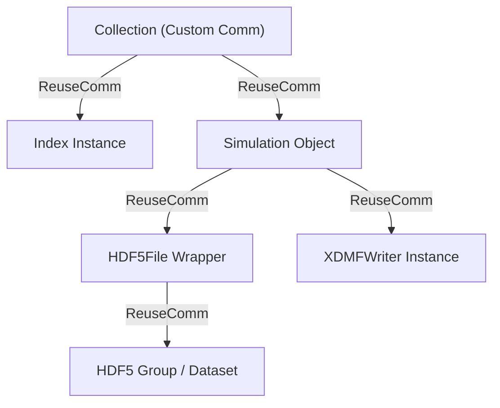

import { Callout } from "fumadocs-ui/components/callout";

Bamboost is designed to scale seamlessly from interactive single-process scripts on a
laptop to highly parallelized simulation workflows running on High-Performance Computing
(HPC) clusters.

To achieve this, Bamboost integrates native Message Passing Interface (MPI) capabilities,
allowing multiple processes to collaborate when managing, indexing, and writing scientific
datasets in HDF5 format.

This guide provides a comprehensive overview of how parallel execution works in Bamboost,
how to write MPI-safe code, and the underlying architectural patterns of the codebase.

---

## MPI Auto-Detection & The Serial Mock

### The Proxy Pattern: `bamboost.mpi.MPI`

To avoid unnecessary overhead and simplify local development, Bamboost uses a **proxy
pattern** to abstract the underlying MPI engine.

<Callout type="warn">
**Always import `MPI` from Bamboost** instead of `mpi4py` directly:

```python
from bamboost.mpi import MPI
```
</Callout>

Upon import, Bamboost dynamically detects the execution context and selects the
appropriate backend:

1. **Real MPI**: If MPI detection succeeds and `mpi4py` is installed, Bamboost loads the
   real `mpi4py.MPI` module and sets `MPI.enabled = True`.
2. **Serial Fallback (Mock MPI)**: If no MPI environment is detected, Bamboost falls back
   to its serial mock submodule (`bamboost.mpi.serial`) and sets `MPI.enabled = False`.

### Activating MPI Mode

By default, `config.options.mpi` is `False`. You can enable MPI detection using one of
these three methods:

| Method | Configuration | Description |
| :--- | :--- | :--- |
| **Environment Override** (Highest Priority) | `export BAMBOOST_MPI=1` | Forces MPI detection and initialization. Use `=0` to explicitly disable. |
| **Config File** | `[options]` `mpi = true` in `bamboost.toml` | Enables MPI detection; Bamboost then checks for standard launcher environment variables. |
| **Runtime Scripting** | `config.options.mpi = True` | Sets the flag dynamically before the MPI module is used. |

When `config.options.mpi` is enabled, Bamboost checks for standard launcher environment
variables (e.g. `OMPI_COMM_WORLD_SIZE`, `SLURM_PROCID`, `PMI_SIZE`, `I_MPI_RANK`, etc.).
If any are present, MPI is initialized. If none are found, Bamboost logs a warning and
falls back to the serial mock.

<Callout>
Parallel HDF5 requires that your `h5py` installation was compiled with parallel MPI
support. You can verify this with `h5py.get_config().mpi`. If you enable MPI in Bamboost
but `h5py` lacks MPI support, Bamboost raises a `RuntimeError` on startup to prevent
silent data corruption.
</Callout>

### The Serial Mock Module (`serial.py`)

To ensure your code remains completely portable, `bamboost.mpi.serial` exposes the same
communicator interfaces as `mpi4py.MPI`:

- **Communicators**: `COMM_WORLD` and `COMM_SELF` are distinct `SerialComm` instances with
  `rank = 0` and `size = 1`. They are kept as **separate** objects so that code paths
  which distinguish between the two (e.g. inside `comm_self`) behave correctly in serial
  mode.
- **Identity Collective Operations**: `bcast()`, `scatter()`, `gather()`, `allreduce()`,
  and `reduce()` act as identity functions (returning input unchanged). `allgather()`
  returns a single-element list containing the input. `barrier()` is a no-op.
- **Reduction Operators**: `SUM` and `MAX` are provided as plain functions compatible with
  the operator argument of `allreduce`/`reduce`.
- **Fail-Fast `COMM_NULL`**: `COMM_NULL` is a `NullComm` instance. Any attribute access on
  it raises a `RuntimeError` immediately, making programming errors visible during serial
  tests.

---

## Synchronization in UIDs and Names

In parallel execution, generating randomized names or unique identifiers independently on
different ranks leads to desynchronization. Bamboost coordinates these operations
natively.

### `CollectionUID` and `SimulationName`

Both classes are MPI-aware. When initialized with a communicator, they automatically
coordinate across ranks by letting Rank 0 generate the value and broadcasting it:

```python
# Inside CollectionUID.generate_uid / SimulationName.generate_name:
uid = uuid.uuid4().hex[:length]
if comm is not None:
    uid = comm.bcast(uid, root=0)
```

By delegating generation to Rank 0 and broadcasting the result, Bamboost guarantees that
every process in the communicator operates on identical simulation folders, files, and
metadata records.

---

## Communicator Propagation & Descriptors

Managing MPI communicators across nested hierarchies (e.g. from Collections to
Simulations, and down to underlying HDF5 files and writers) is handled by a custom
**`Communicator` descriptor** and the **`ReuseComm` marker class**.

### Custom Communicators

You can pass a custom or split sub-communicator when instantiating a `Collection`:

```python
from bamboost import Collection
from bamboost.mpi import MPI

comm = MPI.COMM_WORLD
# Split the communicator to run concurrent simulation batches
color = comm.rank % 2
sub_comm = comm.Split(color, comm.rank)

# Pass the custom sub-communicator during Collection initialization
collection = Collection("/path/to/my/data", comm=sub_comm)
```

### Auto-Propagation Mechanism

When a communicator is specified on a parent object, all nested objects inherit it
automatically through the `ReuseComm` marker. Child objects register themselves via
`self._comm = ReuseComm(parent)`, and the `Communicator` descriptor traverses the
parent chain at access time to resolve the active communicator.



The `Communicator` descriptor maintains two weak-reference lookup tables
(`_child_to_parent_map` and `_instance_comms`). When a child object accesses its `_comm`
attribute, Bamboost traverses the weak-reference parent chain to locate and reuse the
active communicator instance. If no parent in the chain has an explicitly set communicator,
`MPI.COMM_WORLD` is returned as the default.

---

## Writing Large Datasets in Parallel (MPIO)

For raw numerical datasets, Bamboost leverages HDF5's parallel MPIO driver
(`driver="mpio"`), enabling all MPI processes to write their chunks to the same file
concurrently.

<Callout type="tip">
While these writes are collective if a real communicator is present, the
following functions are perfectly **safe to call in serial mode** as well, since
the mock communicator simply executes them as identity operations.
</Callout>

### Unified Entry Point (`write_distributed_array`)

The primary method for parallel writing is `write_distributed_array`. It dispatches to
contiguous or scattered writing based on whether `indices` is provided:

```python
# Contiguous write (indices=None, default)
group.write_distributed_array("positions", local_data)

# Scattered write (non-contiguous global positions)
group.write_distributed_array("dof_data", local_data, indices=global_indices)
```

<Callout type="tip" title="Series fields">

`StepWriter.add_field(...)` uses `write_distributed_array` under the hood, so
these parallel writing capabilities are also available when writing to series
fields.

The default for `add_field` is `indices=None`, which means it will call the contiguous variant.
`indices` can be used with a local-to-global `dof_map` in a FEM context.
However, consider that non-contiguous writes are much slower.

</Callout>

### A. Contiguous Distributed Arrays (`write_distributed_contiguous_array`)

Use this when each rank holds a portion of a larger contiguous array. The ranks
collectively run `allgather` to determine the global shape and calculate
non-overlapping slice offsets automatically:

```python
import numpy as np
from bamboost import Collection
from bamboost.mpi import MPI

comm = MPI.COMM_WORLD
collection = Collection("./data", comm=comm)

# Simulation creation is a collective action!
sim = collection.add("parallel_contiguous_sim", override=True)

# Generate local data chunk on each rank
local_size = 50
local_data = np.random.rand(local_size, 3)

# Write collectively inside edit context
with sim.edit() as writer:
    # All ranks MUST enter this block and call this collectively
    writer.root.write_distributed_contiguous_array("positions", local_data)
```

### B. Scattered Distributed Arrays (`write_distributed_scattered_array`)

Use this when processes write to non-contiguous positions in a global array (e.g. finite
element Degree of Freedom maps). Bamboost sorts the local indices and permutes the
corresponding data on each rank to satisfy HDF5's strictly increasing index constraint.
The global dataset size is determined via `allreduce(MPI.MAX)` on the maximum index across
all processes:

```python
with sim.edit() as writer:
    # Each rank specifies its target global index mapping and values
    global_indices = np.array([comm.rank, comm.rank + comm.size], dtype=np.int64)
    local_data = np.array([float(comm.rank), float(comm.rank * 10)], dtype=np.float64)

    # All ranks execute this together
    writer.root.write_distributed_scattered_array(
        "scattered_sensor_data",
        indices=global_indices,
        vector=local_data,
    )
```

---

## Collective Metaprogramming (`RootProcessMeta`)

Certain operations — such as writing to the SQLite index database, updating structural
XMLs (`XDMFWriter`), or modifying HDF5 metadata attributes — must only be executed by a
single process to avoid race conditions and file lock contentions.

Bamboost solves this with **`RootProcessMeta`** (`bamboost.mpi.utilities`), a metaclass
that automatically makes classes MPI-safe.

### Automatic Method Wrapping

When a class uses `RootProcessMeta`, all its callable methods are automatically wrapped
during class creation. The only exceptions are:
- Methods in `__exclude__` (`__init__`, `__new__`)
- `staticmethod` and `classmethod` definitions
- Methods explicitly decorated with `@RootProcessMeta.exclude`

Every other method is wrapped with `@RootProcessMeta.bcast_result`:

```python
@staticmethod
def bcast_result(func):
    @wraps(func)
    def wrapper(self, *args, **kwargs):
        status = True
        result = None
        exc = None

        if self._comm.rank == 0:
            try:
                # Rank 0 temporarily switches comm to COMM_SELF to avoid nested deadlocks
                with comm_self(self):
                    result = func(self, *args, **kwargs)
            except Exception as e:
                status = False
                exc = e

        # Synchronize status, result, and exceptions collectively across all ranks
        broadcast_data = self._comm.bcast((status, result, exc), root=0)

        # If Rank 0 encountered an exception, raise it collectively on all processes
        if not broadcast_data[0]:
            raise broadcast_data[2]

        return broadcast_data[1]

    return wrapper
```

The `@RootProcessMeta.exclude` decorator marks a method to run independently on **all
ranks** without any MPI synchronization (useful for context managers or collective
operations that are already safe).

### Key Benefits of this Pattern:

1. **Safety**: Single-process writes are guaranteed because the actual logic runs solely on
   Rank 0.
2. **Crash Resilience**: If Rank 0 encounters an exception, it is broadcast and raised
   collectively on all processes. Non-root ranks never hang indefinitely on subsequent
   collective barriers.
3. **Transparency**: Non-root ranks automatically receive and return the serialized result
   of the method call as if they had executed it locally.

### Deferred Attribute Writing (`SingleProcessQueue`)

Modifying HDF5 file metadata (like adding dataset attributes) in the middle of a parallel
MPIO session can cause driver lockups.

Bamboost handles this with a hybrid execution queue:

1. Inside `write_distributed_contiguous_array` (and the scattered variant), raw arrays are
   written concurrently using MPIO.
2. Any metadata modifications (e.g. updating dataset `attrs`) are instead deferred via
   `post_write_instruction(...)` into a `SingleProcessQueue`. `SingleProcessQueue` itself
   uses `RootProcessMeta`, so all of its methods run only on Rank 0.
3. When the outermost `HDF5File` context closes on all ranks, `close()` triggers
   `single_process_queue.apply()`. This opens the file in standard `append` mode (no MPIO
   driver) and flushes the queue sequentially, executing all deferred metadata writes
   cleanly.

<Callout>
If the file is not open under the MPIO driver (or is already closed), `post_write_instruction`
executes the instruction **immediately** rather than deferring it. This avoids unnecessary
queuing for serial or single-process usage.
</Callout>

---

## Preventing Deadlocks with `comm_self`

A nested collective deadlock is a classic MPI hazard. It occurs when a method wrapped by
`RootProcessMeta` (running only on Rank 0) internally calls another wrapped method. Rank 0
blocks waiting for an inner `bcast`, while non-root ranks are blocked waiting for the
outer `bcast`.

Bamboost avoids this using the **`comm_self`** context manager:

```python
from bamboost.mpi.utilities import comm_self
```

Inside a `with comm_self(obj):` block, the target object's active communicator is
temporarily swapped to `MPI.COMM_SELF`. Since `COMM_SELF` has only one rank, all inner
collective operations and broadcasts resolve instantly without waiting for other processes.

`RootProcessMeta.bcast_result` uses `comm_self` automatically when calling the wrapped
function on Rank 0, which is why nested `RootProcessMeta` calls do not deadlock.

### When should you use `comm_self`?

If you are writing a **custom** routine that runs *only* on Rank 0 (for example, inside
an `if rank == 0:` block) and need to call Bamboost operations, you **must** wrap them
in a `comm_self` context to bypass the global communicator:

```python
if comm.rank == 0:
    # Run some custom single-process analytical step
    with comm_self(sim):
        # Without comm_self this would deadlock — other ranks are not participating
        sim.data.root.add_dataset("single_process_metadata", [1.0, 2.0, 3.0])
```

<Callout type="warn">
`comm_self` correctly handles both serial mock communicators and real `mpi4py`
communicators: it swaps the mock `COMM_SELF` for serial runs and the real
`mpi4py.MPI.COMM_SELF` for genuine MPI runs, avoiding import overhead in serial mode.
</Callout>

---

## Best Practices and Checklist

- [x] **Import `MPI` from `bamboost.mpi`**: Never use `from mpi4py import MPI` directly
  inside your Bamboost workflows. This allows you to write code that is
  portable between serial and parallel execution without modification.
- [x] **Pass `comm` during `Collection` initialization**: This ensures all nested objects
  and index instances inherit the correct communicator automatically.
- [x] **Collective Simulation Creation**: Always create or add simulations collectively on
  all processes to ensure unique IDs and names remain synchronized:
  ```python
  # Run collectively across all ranks!
  sim = collection.add("my_mpi_simulation", override=True)
  ```
- [x] **Dataset writes must be collective**: Never place
  `write_distributed_contiguous_array`, `write_distributed_scattered_array`, or
  `write_distributed_array` inside rank-conditional blocks (e.g. `if rank == 0:`). These
  are collective operations and require participation from all ranks.
- [x] **Wrap Rank 0 conditional blocks**: If you perform any non-collective Bamboost
  operations inside an `if rank == 0:` block, always wrap them in
  `with comm_self(obj):` to avoid deadlocks.
- [x] **Install parallel HDF5**: Verify that `h5py` is compiled against your system's MPI
  implementation (`h5py.get_config().mpi` must be `True`).
